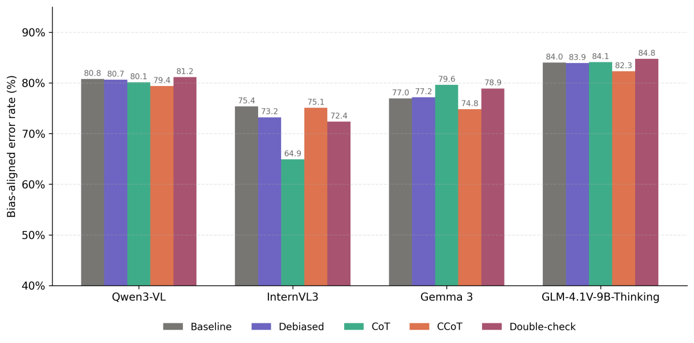
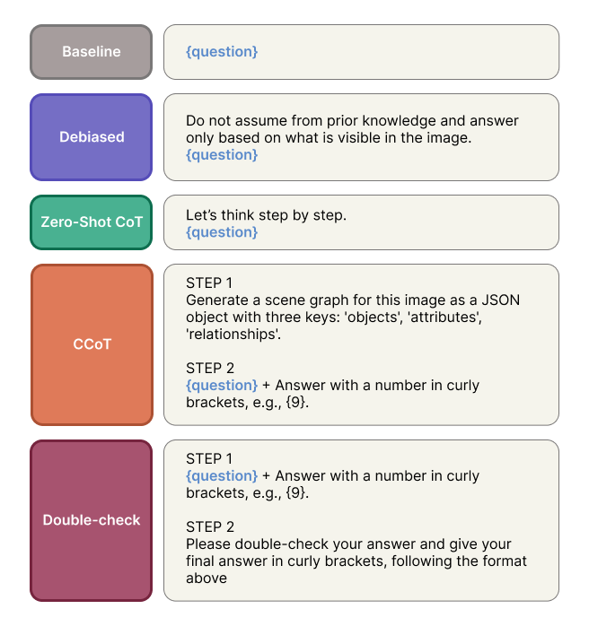

# Can Structured Prompting Overcome Knowledge Bias in Vision-Language Models?

Kyrylo Kolesnichenko, Martas Ambraziunas.
*Information Society and University Studies (IVUS 2026), CEUR Workshop Proceedings.* Presented, to appear.

Vision-language models often answer from what they remember instead of what is in the image:
shown an Adidas logo with four stripes, a model may still answer three. Vo et al. measured this
on closed API models with the [VLMBias](https://huggingface.co/datasets/anvo25/vlms-are-biased)
benchmark. This repository asks two questions:

1. Does the same knowledge bias show up in smaller open-source VLMs?
2. Can more structured prompting reduce it?



## Setup

| | |
|---|---|
| Models | Qwen3-VL-8B-Instruct, InternVL3-8B, Gemma 3 12B (it), GLM-4.1V-9B-Thinking |
| Benchmark | VLMBias `main` split: 2,784 counterfactual images in 7 domains |
| Prompting | 5 strategies (below), greedy decoding (temperature 0) |
| Inference | vLLM on one A100 or H100 GPU |
| Statistics | McNemar test against the baseline prompt, Bonferroni-corrected (α = 0.05 / 4 per model), bootstrap 95% CI |



| strategy | what the model gets |
|---|---|
| `baseline` | the original VLMBias question |
| `debiased` | *"Do not assume from prior knowledge and answer only based on what is visible in the image."* + question |
| `cot` | zero-shot chain-of-thought: *"Let's think step by step…"* |
| `ccot` | compositional CoT, two turns: first a scene graph (objects, attributes, relationships), then the question with the scene graph as context |
| `doublecheck` | two turns: the question, then *"Please double-check your answer…"* |

## Results

Accuracy (%) on all 2,784 questions:

| model | baseline | debiased | CoT | CCoT | double-check |
|---|---:|---:|---:|---:|---:|
| Qwen3-VL-8B | 19.32 | 20.19 | 20.87 | 19.65 | 19.25 |
| InternVL3-8B | 20.15 | 21.01 | 16.70 | 22.59 | 21.05 |
| Gemma 3 12B | 17.56 | 19.11 | 19.04 | 17.28 | 17.74 |
| GLM-4.1V-9B-Thinking | 22.95 | 20.73 | 24.64 | 20.01 | 23.31 |

Bias-aligned error rate (%): of the wrong answers, how many give the answer prior knowledge
would predict:

| model | baseline | debiased | CoT | CCoT | double-check |
|---|---:|---:|---:|---:|---:|
| Qwen3-VL-8B | 80.77 | 80.65 | 80.14 | 79.39 | 81.17 |
| InternVL3-8B | 75.38 | 73.22 | 64.94 | 75.08 | 72.38 |
| Gemma 3 12B | 76.95 | 77.18 | 79.64 | 74.82 | 78.91 |
| GLM-4.1V-9B-Thinking | 84.01 | 83.94 | 84.11 | 82.32 | 84.77 |

- The open-source models behave like the API models: about 17–23% accuracy, and 65–85% of the
  errors are bias-aligned.
- Of the 16 comparisons against the baseline prompt, 6 are significant after correction:
  InternVL3 CoT (−3.45 pp) and CCoT (+2.44 pp), Gemma 3 debiased (+1.54 pp), GLM-4.1V debiased
  (−2.23 pp), CoT (+1.69 pp) and CCoT (−2.95 pp).
- The effects depend on the model. No strategy helps all four.

Prompting alone does not reliably reduce knowledge bias in these models.

Full tables, including accuracy per domain and every significance test, are in
[`results/tables/`](results/tables/) (CSV, and `main_accuracy.tex` for LaTeX).

## Run it

Needs an NVIDIA GPU with enough memory for a 12B model in vLLM (an A100 or H100). The full run
is about 8–10 hours on one H100 and resumes after an interruption.

```bash
pip install -r requirements.txt
python run.py --mode sample                       # 1 image, all 5 prompts: check the setup
python run.py --mode all                          # inference + answer extraction + tables
python run.py --mode inference --model gemma3_12b # one model only
python run.py --mode evaluate                     # rebuild the tables from results/extracted/
```

On Google Colab, open `vlmbias_experiment.ipynb` with a GPU runtime.

To rebuild the tables from the outputs included here without running the models:

```bash
gunzip -k results/raw/*.jsonl.gz results/extracted/*.jsonl.gz
python run.py --mode evaluate
```

## What is in here

```
run.py                     entry point: sample / inference / extract / evaluate / all
config.py                  models, prompt texts, sampling settings, paths
prompts.py                 builds the five prompts (single- and two-turn)
data.py                    loads and checks the VLMBias dataset
inference.py               vLLM inference, batched, with checkpoints
extract.py                 pulls the {answer} out of each response (strips <think> for GLM)
evaluate.py                accuracy, bias-aligned errors, McNemar, bootstrap CIs, tables
vlmbias_experiment.ipynb   the same pipeline as a Colab notebook
results/raw/               every model response (JSONL, gzipped)
results/extracted/         responses with the extracted answer and correctness (JSONL, gzipped)
results/tables/            the result tables (CSV, LaTeX)
figures/                   the figures above
```

Each extracted record holds the sample ID, topic, ground truth, expected (biased) answer, prompt
condition, full prompt, raw response, extracted answer, and whether it is correct or a
bias-aligned error.

## Citation

```bibtex
@inproceedings{kolesnichenko2026structured,
  title     = {{Can Structured Prompting Overcome Knowledge Bias in Vision-Language Models?}},
  author    = {Kolesnichenko, Kyrylo and Ambraziunas, Martas},
  booktitle = {Information Society and University Studies (IVUS 2026), CEUR Workshop Proceedings},
  year      = {2026},
  note      = {To appear}
}
```

The benchmark is from Vo et al., *Vision Language Models are Biased*; please cite it as well if
you use the data.
